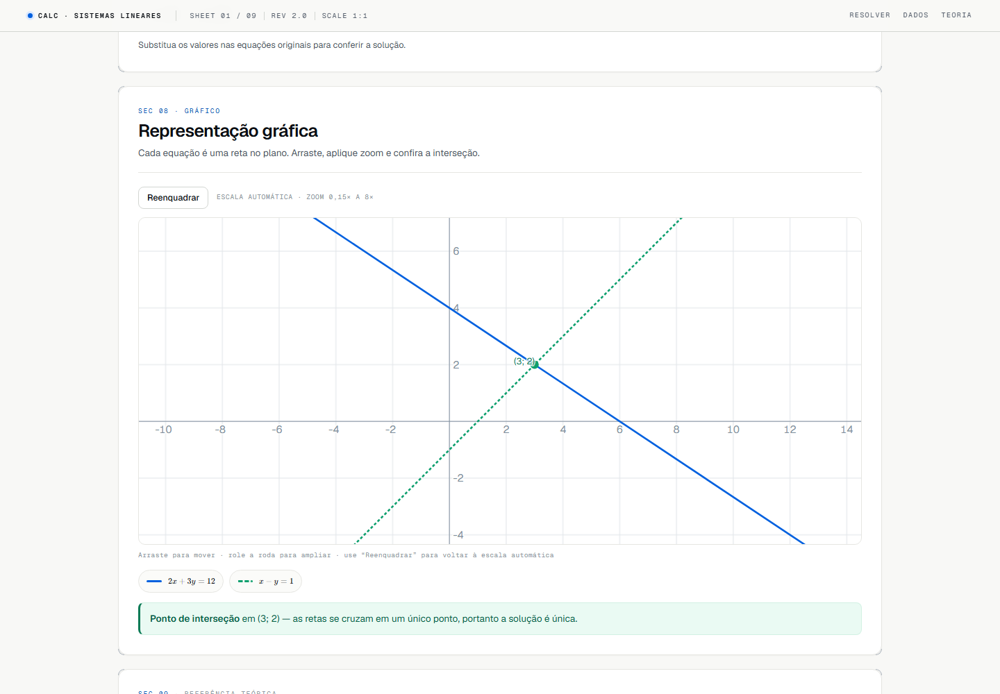

# Calculadora de Sistemas Lineares

**Resolva, classifique e entenda sistemas lineares — de 1 a 5 equações e de 2 a 5 incógnitas — com passo a passo de Gauss-Jordan, solução paramétrica e gráfico interativo.**

Uma aplicação web em português (pt-BR), feita para estudantes e professores verem não só o resultado, mas *como* ele foi obtido. Roda 100% no navegador, sem servidor, sem cadastro e sem internet.

**[▶ Abrir a calculadora](https://kaioViniciusP.github.io/Calculadora-de-Sistema-lineares/)** · **[📘 Documentação técnica](docs/DOCUMENTACAO.md)** · **[🧭 Guia de uso](docs/GUIA-DE-USO.md)**


---

## Índice

- [Recursos](#recursos)
- [Documentação](#documentação)
- [Como usar](#como-usar)
- [Como o sistema é resolvido](#como-o-sistema-é-resolvido)
- [Como foi feito](#como-foi-feito)
- [Estrutura do projeto](#estrutura-do-projeto)
- [Rodar localmente](#rodar-localmente)
- [Build de arquivo único](#build-de-arquivo-único)
- [Publicação no GitHub Pages](#publicação-no-github-pages)
- [Limitações](#limitações)
- [Créditos](#créditos)

---

## Recursos

### Entrada flexível

- **1 a 5 equações** e **2 a 5 incógnitas** (x, y, z, w, v).
- Grade editável de coeficientes + termos independentes.
- Aceita inteiros, decimais com vírgula ou ponto, negativos, zero e frações como `1/2`.
- Campos vazios são tratados como `0`; entradas inválidas são destacadas com mensagem.
- **12 exemplos prontos**: SPD, SPI e SI de 2×2 a 5×5, incluindo o sistema do Projeto Integrador.

### Resolução matemática

- **Eliminação de Gauss-Jordan** com pivoteamento parcial.
- Passo a passo completo: troca de linhas, normalização do pivô e eliminação, com a matriz ampliada em cada operação.
- **Classificação por postos** de A e (A|B): SPD, SPI ou SI.
- Conjunto solução único, **paramétrico** (com variáveis livres) ou vazio (`S = ∅`).
- Tolerância relativa de `1e-9 × max|A|` para tratar ruído de ponto flutuante.

### Visualização e estudo

- Gráfico 2D interativo com **Mafs**: retas, ponto de interseção, zoom, pan e reenquadramento.
- Para 3+ incógnitas, explicação geométrica com planos em vez de um gráfico enganoso.
- Seção teórica sobre SPD, SPI e SI e sobre o método usado.
- Botões de **copiar resultado** e **imprimir / gerar PDF** com layout próprio.
- Interface responsiva, acessível por teclado e com atalho `Enter` para resolver.

---

## Documentação

| Documento | Conteúdo |
|---|---|
| **[Documentação técnica](docs/DOCUMENTACAO.md)** | Visão geral, requisitos, arquitetura, módulos, modelo matemático, interface, build, validação, limitações e manutenção. |
| **[Guia de uso](docs/GUIA-DE-USO.md)** | Passo a passo para o usuário, formatos de entrada, leitura dos resultados, atalhos e perguntas frequentes. |

---

## Como usar

### 1. Escolha as dimensões

Em **SEC 01 · Configuração**, selecione a quantidade de incógnitas e de equações e clique em **Gerar matriz**.

### 2. Preencha os coeficientes

Em **SEC 02 · Entrada de dados**, digite os coeficientes e o termo independente de cada equação.

Exemplo:

```
2x + y + 3z = 190
 x + 3y + 2z = 190
 x + 2y + 2z = 160
```

Na grade, a última coluna é o termo independente:

| x | y | z | = |
|---|---|---|---|
| 2 | 1 | 3 | 190 |
| 1 | 3 | 2 | 190 |
| 1 | 2 | 2 | 160 |

> Dica: use **Exemplo preenchido** ou escolha um exemplo pronto no seletor. Pressione `Enter` em qualquer campo para resolver.

### 3. Resolva

Clique em **Resolver sistema**. A “prancha” de resultados é gerada com:

| Seção | O que mostra |
|---|---|
| **SEC 03 · Sistema** | O sistema montado a partir da matriz, em notação matemática |
| **SEC 04 · Representação matricial** | A, X, B e a matriz ampliada (A\|B) |
| **SEC 05 · Passo a passo** | Todas as operações de Gauss-Jordan, pivô por pivô |
| **SEC 06 · Classificação** | Postos, número de soluções e o critério aplicado |
| **SEC 07 · Conjunto solução** | Valores únicos, forma paramétrica ou conjunto vazio |
| **SEC 08 · Gráfico** | Retas, interseção e zoom (2 incógnitas) ou leitura geométrica (3+) |
| **SEC 09 · Teoria** | Referência sobre SPD, SPI, SI e o método |


### 4. Explore o gráfico

Com **2 incógnitas**, cada equação vira uma reta. Arraste para mover, use a roda do mouse ou o gesto de pinça para o zoom e clique em **Reenquadrar** para voltar à escala automática.



Com **3 ou mais incógnitas**, a aplicação explica por que o desenho 2D não representa corretamente o problema e mostra a interpretação de planos no espaço, coerente com a classificação.

### 5. Copie ou imprima

- **Copiar resultado** gera um resumo em texto para colar no relatório.
- **Imprimir / PDF** abre a impressão do navegador já sem os controles, preservando resultados e gráfico.

### Classificações

| Classificação | Critério | Leitura geométrica (2D) |
|---|---|---|
| **SPD** — Sistema Possível e Determinado | `posto(A) = posto(A\|B) = n` | Retas concorrentes em um ponto |
| **SPI** — Sistema Possível e Indeterminado | `posto(A) = posto(A\|B) < n` | Retas coincidentes |
| **SI** — Sistema Impossível | `posto(A) ≠ posto(A\|B)` | Retas paralelas distintas |

---

## Como o sistema é resolvido

O núcleo está em [`codigo-fonte/src/lib/solver.js`](codigo-fonte/src/lib/solver.js) e não usa bibliotecas de álgebra linear.

1. **Matriz ampliada** — os coeficientes e os termos independentes são reunidos em `(A|B)`.
2. **Pivoteamento parcial** — em cada coluna, escolhe-se o maior elemento em módulo para reduzir erro numérico.
3. **Eliminação de Gauss-Jordan** — o pivô é normalizado para 1 e a coluna é zerada nas demais linhas, registrando cada operação elementar.
4. **Postos** — contam-se as linhas não nulas de A e de (A|B), desconsiderando valores dentro da tolerância.
5. **Classificação** — aplica-se o critério de Rouché–Capelli:
   - `posto(A) ≠ posto(A|B)` → **SI**;
   - `posto(A) = posto(A|B) = n` → **SPD**;
   - `posto(A) = posto(A|B) < n` → **SPI**.
6. **Solução** — para SPI, as variáveis livres recebem parâmetros (`t, s, u, r, q`) e as variáveis pivô são escritas em função delas.
7. **Limpeza numérica** — valores muito próximos de zero e de inteiros são normalizados antes da exibição, evitando `0.0000000001` e `2.9999999999`.

A tolerância é relativa à maior entrada de A (`1e-9 × max|A|`), porque a escala dos coeficientes muda de problema para problema.

---

## Como foi feito

### Stack

| Camada | Tecnologia |
|---|---|
| Interface | **React 18** |
| Build | **Vite 7** com `vite-plugin-singlefile` |
| Matemática na tela | **KaTeX 0.16** |
| Gráfico 2D | **Mafs 0.21** |
| Tipografia | **Geist Sans** e **Geist Mono** via `@fontsource-variable` |
| Estilo | CSS próprio, sem framework |

### Decisões de projeto

- **KaTeX em vez de MathJax** para renderizar sistemas, matrizes e operações com tipografia matemática precisa e sem dependência de CDN.
- **Mafs em vez de canvas manual** para ganhar zoom, pan e coordenadas interativas com comportamento consistente.
- **Fontes locais** (`@fontsource-variable`) para o app funcionar offline.
- **Build em arquivo único** (`vite-plugin-singlefile`): JS, CSS e fontes são embutidos em um só `index.html`, que abre com duplo clique.
- **Tolerância relativa** em vez de comparação absoluta com zero, mais adequada a coeficientes de escalas diferentes.
- **Sem gráfico falso para 3+ incógnitas**: a aplicação declara a limitação e apresenta a leitura geométrica correta.

### Design

A interface segue uma mistura de **Geist** (Vercel) com **Meridian Blueprint** (Kombai):

- fundo claro com grid técnico, azul de planta e detalhes em verde;
- barra de carimbo `SHEET 01 / 09 · REV 2.0 · SCALE 1:1`;
- seções numeradas `SEC 01` a `SEC 09`, cantos técnicos e cartões de 1 px;
- tipografia mono para metadados e números tabulares;
- layout responsivo, com tabela que cabe até 5 incógnitas no celular.

---

## Estrutura do projeto

```
.
├── index.html                  # build publicado (arquivo único, abre sozinho)
├── docs/
│   ├── DOCUMENTACAO.md         # documentação técnica do sistema
│   ├── GUIA-DE-USO.md          # manual do usuário
│   ├── preview.png             # capturas usadas neste README
│   ├── solucao.png
│   └── grafico.png
├── codigo-fonte/
│   ├── index.html              # HTML de entrada do Vite
│   ├── package.json
│   ├── vite.config.js
│   └── src/
│       ├── App.jsx             # estado, resolução, exemplos, copiar/imprimir
│       ├── main.jsx            # entrada React + fontes + CSS
│       ├── styles.css          # tela e impressão
│       ├── components/
│       │   ├── SheetHeader.jsx # barra de carimbo
│       │   ├── Sections.jsx    # seções SEC 01 a 09
│       │   ├── MatrixInput.jsx # grade editável
│       │   ├── GraphView.jsx   # gráfico Mafs e leitura 3D
│       │   └── Tex.jsx         # renderizador KaTeX
│       └── lib/
│           ├── solver.js       # Gauss-Jordan, postos, classificação
│           ├── latex.js        # construtores de LaTeX
│           └── examples.js     # exemplos e redimensionamento
└── README.md
```

> `index.html` na raiz é **gerado**. Para alterar o app, edite `codigo-fonte/src/` e refaça o build.

---

## Rodar localmente

Requisitos: **Node.js 20+**.

```bash
cd codigo-fonte
npm install
npm run dev
```

No Windows, se o PowerShell bloquear `npm.ps1`, use `npm.cmd`:

```powershell
npm.cmd install
npm.cmd run dev
```

Abra o endereço indicado pelo Vite (normalmente `http://localhost:5173`).

---

## Build de arquivo único

```bash
cd codigo-fonte
npm run build
```

O resultado é `codigo-fonte/dist/index.html`, autocontido. Para publicar, copie sobre o `index.html` da raiz:

```powershell
Copy-Item codigo-fonte\dist\index.html index.html -Force
```

Também é possível abrir o build direto do disco (`file://`), sem servidor e sem internet.

---

## Publicação no GitHub Pages

O repositório é público e o Pages serve o `index.html` da branch `main`:

1. **Settings → Pages**
2. **Source:** *Deploy from a branch*
3. **Branch:** `main` · **Folder:** `/ (root)`

O endereço fica no formato:

```
https://kaioViniciusP.github.io/Calculadora-de-Sistema-lineares/
```

---

## Limitações

- Os cálculos usam ponto flutuante de precisão dupla. A tolerância reduz, mas não elimina, os efeitos de arredondamento em sistemas muito mal condicionados.
- O gráfico cartesiano só representa corretamente sistemas com **2 incógnitas**. Para 3+, a aplicação apresenta a leitura geométrica em vez de um desenho incorreto.
- Dimensões limitadas a **1–5 equações** e **2–5 incógnitas** por decisão de interface.
- O foco é didático: mostrar o método e o significado do resultado, não substituir software de álgebra linear de alta performance.

---

## Créditos

Desenvolvido como parte do **Projeto Integrador de Matemática Aplicada à Computação II**.

Bibliotecas e referências: [React](https://react.dev/), [Vite](https://vite.dev/), [Mafs](https://mafs.dev/), [KaTeX](https://katex.org/), [Geist](https://vercel.com/geist/introduction) e [Meridian Blueprint](https://agent.kombai.com/kombai-inspiration-library/templates/meridian-blueprint/index.html).

Se este projeto te ajudou a estudar, deixe uma ⭐ no repositório.
